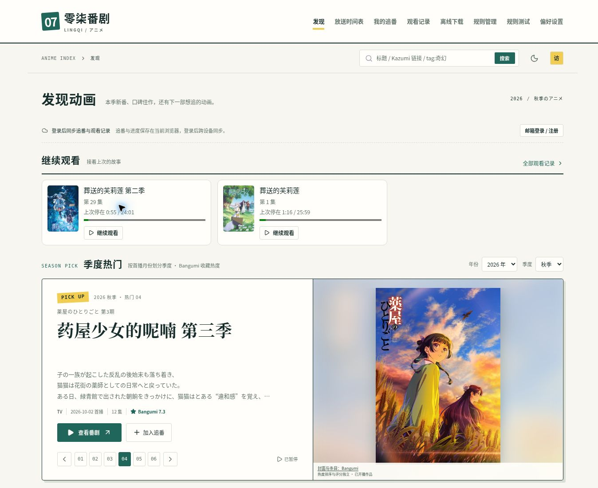
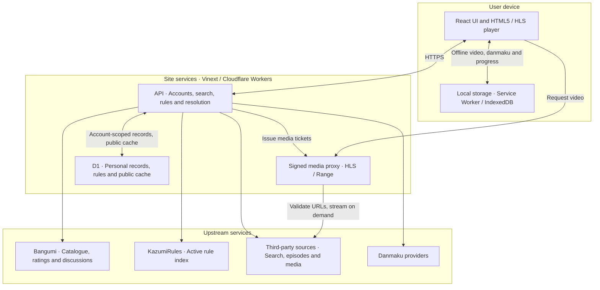

<div align="center">


# Lingqi Anime · 零柒番剧

**Find your next story. Pick up where you left off.**

An anime index, watch journal and personal screening room in your browser.

[简体中文](README.md) · **English**

**[Try it live ↗](https://lingqi-anime.tarokiki.chatgpt.site)** · [Features](#features) · [Architecture](#architecture) · [Run locally](#run-locally) · [Documentation](#documentation)

[](LICENSE)
[](package.json)
[](build/sites-worker.ts)
[](docs/architecture.md)

</div>


Lingqi Anime is an independent Web client inspired by [Kazumi](https://github.com/Predidit/Kazumi). Discover anime through Bangumi, find sources through open rules, and watch, track, resume and save episodes in one place.

No native app is required. Guests can browse and play; a site email account enables cross-device library sync. The application interface is currently primarily Simplified Chinese. This English README documents the same project and features.

## Try it live

**Website: [https://lingqi-anime.tarokiki.chatgpt.site](https://lingqi-anime.tarokiki.chatgpt.site)**

1. Search for a title on Discover, or switch seasons to explore popular anime.
2. Open a title, then select an episode and source. Source checks distinguish an episode directory from verified playback.
3. Add a title to your watchlist, resume an episode, or let “What to watch tonight” pick from your list.

<details>
<summary><strong>View the live homepage · Seasonal picks, search and episode resume</strong></summary>



Captured on 2026-11-14 using guest test records. Recommendations and ratings change with Bangumi data; anime artwork belongs to its respective owners. The sunset cover above is a brand illustration, shown separately from this real screenshot.

</details>

## Features

| Your goal | What Lingqi offers |
| --- | --- |
| **Find your next anime** | Rotating seasonal picks, weekly schedules, Bangumi ratings, type/year/tag filters, random picks and screenshot-based search. Popularity uses collection heat; scores come from Bangumi. |
| **Spend less time finding a source** | Keywords, aliases, search shortcuts and per-title episode-directory checks. Local recent playback success and startup time inform source ranking; controls stay in place during checks, with manual reordering available. |
| **Enjoy an episode** | In-site MP4/WebM/HLS playback, episode navigation, speed controls, gestures, custom shortcuts, subtitles, picture in picture, a 1–180 minute sleep timer, low-memory playback and diagnostics. Optional Anime4K upscaling through WebGPU. |
| **Pick up where you left off** | Watchlist states, aired-but-unwatched episode summaries, episode-level progress and cross-source resume. Guest records stay local; email accounts sync watchlists, history, aliases and danmaku preferences through D1. |
| **Watch and talk together** | External danmaku matching/import, blocking and synced preferences, site danmaku posting/withdrawal, and title/episode discussions. Offline danmaku and per-title lookup history are available. |
| **Save it for an offline evening** | Native browser downloads, an in-site offline library, batch tasks, MP4/HLS chunk resume, actual transfer progress and a storage panel. Video stays on the user's device, outside D1. |
| **Keep your rules open** | Shared rules follow the active KazumiRules index without requiring login. Custom rules, a rule test page, JSON backups, search sharing and screenshot candidate management are included. |

## Architecture



- The **browser** owns the UI, playback and local offline library, including guest records and pending sync operations.
- The **Worker** handles upstream requests, rule parsing, authentication and the bounded media proxy. Remote scripts are not executed in the application context.
- **D1** stores accounts, personal records, shared rules and public cache entries. Private records are authorized separately from shared cache data. Video files are not stored in D1; R2 is currently unused.

See [Architecture and deployment](docs/architecture.md) for data flows, configuration and security boundaries.

## Run locally

Install **Node.js ≥ 22.13** and **pnpm 11.25.0**, then run:

```sh
git clone https://github.com/FlashPoint007/lingqi-anime.git
cd lingqi-anime
pnpm install --frozen-lockfile
pnpm dev
```

Ordinary local development defaults to `http://localhost:5173`; follow the URL printed by your terminal. Full account and playback functionality also requires local D1 migrations and runtime secrets. Deploy your own copy with your own Site identity and database; see [Development and deployment](docs/architecture.md#development-and-deployment).

Useful checks:

```sh
node scripts/check-web.mjs
node scripts/check-player.cjs
node scripts/check-source-order.cjs
pnpm exec tsc --noEmit
pnpm build
```

## Availability and browser limits

A source marked as having episodes has a matching directory; this does not guarantee that every episode plays. Third-party sites can time out, require human verification or change their APIs. The application does not bypass CAPTCHAs or DRM. Native browser downloads and the in-site offline library have different format, resume and page-lifecycle behavior; see the [Offline notes](docs/resume-share-and-personal-tools.md).

WebGPU, Cast, AirPlay and picture in picture depend on the browser and device. Dandanplay requires credentials authorized for your own deployment; email verification and password recovery require a configured mail sender. Application rate limits, caching and request validation complement hosting-provider protection; network-layer DDoS defense remains a provider responsibility. See the [Technical reference](docs/architecture.md) for configuration and remaining limitations.

## Documentation

Most detailed feature notes below are currently in Chinese; the architecture and deployment reference is bilingual.

| Document | Contents |
| --- | --- |
| [Architecture and deployment](docs/architecture.md) | Stack, storage boundaries, D1, configuration and security |
| [Email accounts](docs/email-accounts.md) | Registration verification, legacy verification, recovery and mail setup |
| [Danmaku integration](docs/danmaku.md) | Providers, authorized credentials and availability limits |
| [Offline, resume and sharing](docs/resume-share-and-personal-tools.md) | Local downloads, resumable transfers, danmaku and sharing |
| [Sources, backlog and capacity](docs/playback-backlog-capacity-v131.md) | Meaning of playback statistics, pending episodes and storage estimates |
| [Recent upstream adaptations](docs/kazumi-update-2026-11-13.md) | Kazumi feature and rule adaptation notes |
| [Upstream feature comparison](docs/upstream-feature-review.md) | Historical native/Web comparison; see recent adaptation notes for subsequent progress |
| [Brand assets](docs/assets/README.md) | Original icon, illustrated cover and screenshot provenance |

## Credits and license

Licensed under [GPL-3.0](LICENSE). Thanks to [Predidit/Kazumi](https://github.com/Predidit/Kazumi) and its contributors for the product inspiration and upstream implementation, and to [KazumiRules](https://github.com/Predidit/KazumiRules) for open rules (with its [MIT license](LICENSE-KazumiRules) retained). Lingqi Anime is an independent browser adaptation, not an official Kazumi product.

Metadata and ratings come from [Bangumi](https://bgm.tv). Anime artwork and related content belong to their respective owners. Anime4K-WebGPU is MIT-licensed and hls.js is Apache-2.0-licensed; other dependencies and distributed assets retain their respective licenses. The new icon and README illustration were created for this project; see [Brand assets](docs/assets/README.md).

Found a bug or have a feature idea? [Open an issue](https://github.com/FlashPoint007/lingqi-anime/issues). For playback reports, include the title, episode, source and error message; leave out account credentials and signed media URLs.
