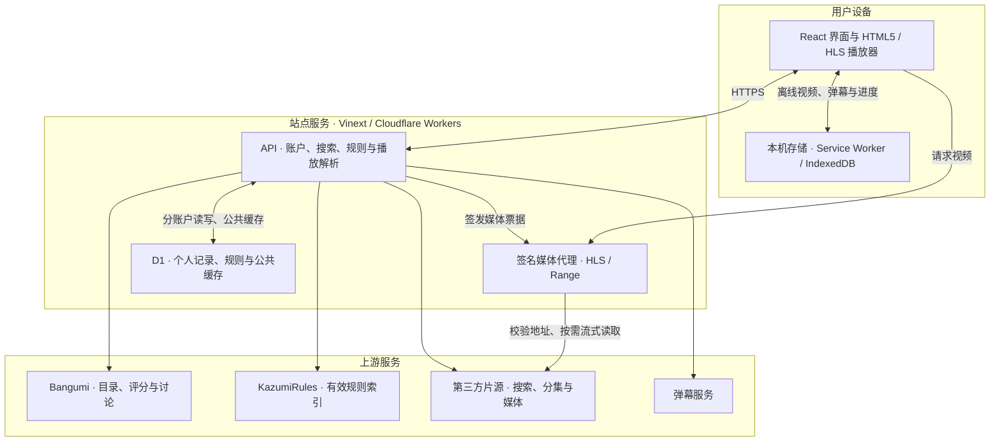

<div align="center">


# 零柒番剧 · Lingqi Anime

**发现好故事，接着看下去。**

浏览器里的动画索引、追番手账与私人放映室。

**简体中文** · [English](README.en.md)

**[在线体验 ↗](https://lingqi-anime.tarokiki.chatgpt.site)** · [功能](#功能一览) · [系统架构](#系统架构) · [本地运行](#本地运行) · [文档](#文档导航)

[](LICENSE)
[](package.json)
[](build/sites-worker.ts)
[](docs/architecture.md)

</div>


零柒番剧是一款受 [Kazumi](https://github.com/Predidit/Kazumi) 启发的独立 Web 客户端。用 Bangumi 找到想看的作品，通过开放规则寻找片源，在本站完成播放、追番、逐集续看和离线收藏。

无需安装客户端，游客也能浏览与播放；登录本站邮箱账号后，可跨设备同步个人记录。界面目前以简体中文为主，英文版项目说明见 [English README](README.en.md)。

## 先来体验

**网站地址：[https://lingqi-anime.tarokiki.chatgpt.site](https://lingqi-anime.tarokiki.chatgpt.site)**

1. 在「发现」搜索片名，或切换季度看看热门作品。
2. 打开番剧详情，选择集数和视频源；检测结果会区分目录匹配与实际起播。
3. 加入追番、从观看记录续播，或在「今晚看什么」让片单替你做一次选择。

<details>
<summary><strong>展开首页实拍 · 季度推荐、搜索与继续观看</strong></summary>


2026-11-14 线上页面实拍，使用游客测试记录。推荐与评分随 Bangumi 数据变化；番剧封面版权归各自权利人所有。上方窗边封面是品牌插画，与网站实拍分别展示。

</details>

## 功能一览

| 想做什么 | 零柒可以帮你 |
| --- | --- |
| **发现下一部动画** | 季度热门轮换、周放送时间表、Bangumi 评分、类型／年份／标签筛选、随机挑番与以图搜番。热门按收藏热度排序，评分来自 Bangumi。 |
| **少花时间找片** | 关键词与别名搜索、搜索快捷语法、按番剧检测片源目录；结合本机近期起播成功率和耗时选源，检测时按钮保持原位，也可手动重新排序。 |
| **舒服地看一集** | 站内 MP4／WebM／HLS 播放、逐集切换、倍速、手势、自定义快捷键、字幕、画中画、1–180 分钟定时暂停、低内存播放与播放诊断；可选 Anime4K WebGPU 超分辨率。 |
| **接着上次看** | 追番状态、已放送待看集数汇总、逐集进度与跨源续播。游客数据留在本机；邮箱账号可将追番、记录、别名和弹幕偏好同步到 D1。 |
| **一起看、一起聊** | 外部弹幕匹配与导入、弹幕屏蔽与偏好同步、本站弹幕发送／撤回、番剧与分集讨论；支持离线弹幕和按番剧回看检索历史。 |
| **留给断网的晚上** | 浏览器原生下载、站内离线放映室、批量任务、MP4／HLS 分片续传、实际传输进度和容量面板。视频保存在用户设备，D1 不保存视频文件。 |
| **掌握自己的规则** | 跟随 KazumiRules 有效索引同步全局规则，游客无需登录；支持自定义规则、规则测试、JSON 备份、分享搜索与截图候选管理。 |

## 系统架构



- **浏览器**负责界面、播放和本机离线库，匿名记录及待同步队列也留在本机。
- **Worker**负责上游请求、规则解析、账户鉴权和受限媒体代理；不在应用上下文执行远端脚本。
- **D1**保存账户、个人记录、共享规则和公共缓存；私人记录与公共缓存分开授权，视频文件不写入 D1，当前未使用 R2。

详细数据流、部署配置和安全边界见 [架构与部署说明](docs/architecture.md)。

## 本地运行

准备 **Node.js ≥ 22.13** 与 **pnpm 11.25.0**，然后执行：

```sh
git clone https://github.com/FlashPoint007/lingqi-anime.git
cd lingqi-anime
pnpm install --frozen-lockfile
pnpm dev
```

普通本地开发默认使用 `http://localhost:5173`，以终端输出为准。完整账户与播放功能还需要本地 D1 迁移和运行时密钥；生产部署需绑定你自己的 Site 与数据库，具体步骤见 [开发与部署](docs/architecture.md#development-and-deployment)。

常用验证：

```sh
node scripts/check-web.mjs
node scripts/check-player.cjs
node scripts/check-source-order.cjs
pnpm exec tsc --noEmit
pnpm build
```

## 使用边界

片源检测中的「有分集」表示找到了目录，不等于每集都能播放。第三方站点可能超时、要求人工验证或调整接口；本站不会绕过验证码或 DRM。原生下载与站内离线库是两种不同方式，支持的格式、续传与页面关闭后的行为见 [离线说明](docs/resume-share-and-personal-tools.md)。

WebGPU、Cast、AirPlay 与画中画依赖浏览器及设备。弹弹play 需要部署者申请本站获授权的凭证；邮箱验证与密码找回需要配置真实邮件发送服务。应用提供限流、缓存和请求校验，网络层 DDoS 防护仍由托管平台承担。配置与其余限制见 [技术说明](docs/architecture.md)。

## 文档导航

| 文档 | 内容 |
| --- | --- |
| [架构与部署](docs/architecture.md) | 技术栈、存储边界、D1、配置与安全 |
| [邮箱账号](docs/email-accounts.md) | 注册验证、旧账号补验、密码找回与邮件配置 |
| [弹幕接入](docs/danmaku.md) | 服务商配置、授权凭证和可用性限制 |
| [离线、续传与分享](docs/resume-share-and-personal-tools.md) | 本机下载、断点恢复、弹幕与分享 |
| [选源、待看与容量](docs/playback-backlog-capacity-v131.md) | 真实起播统计、待看集数和存储估算的含义 |
| [近期上游适配](docs/kazumi-update-2026-11-13.md) | Kazumi 功能与规则适配记录 |
| [上游能力对照](docs/upstream-feature-review.md) | 原生能力与 Web 适配的对照基线；后续进展见近期适配文档 |
| [品牌素材](docs/assets/README.md) | 原创图标、插画封面与截图来源 |

## 致谢与许可

项目使用 [GPL-3.0](LICENSE) 许可。感谢 [Predidit/Kazumi](https://github.com/Predidit/Kazumi) 与贡献者提供的产品灵感和上游实现，以及 [KazumiRules](https://github.com/Predidit/KazumiRules) 的开放规则（保留 [MIT 许可](LICENSE-KazumiRules)）。零柒番剧是独立浏览器适配项目，不代表 Kazumi 官方。

元数据与评分来自 [Bangumi](https://bgm.tv)；番剧封面与相关内容版权归各自权利人所有。Anime4K-WebGPU 使用 MIT 许可，hls.js 使用 Apache-2.0 许可；其他依赖与分发素材保留各自许可。新图标与 README 插画为本项目制作，设计说明见 [品牌素材](docs/assets/README.md)。

发现问题或想提出功能建议？欢迎 [提交 Issue](https://github.com/FlashPoint007/lingqi-anime/issues)。反馈播放问题时请提供作品、集数、片源和错误提示，勿附带账号凭证或签名媒体链接。
