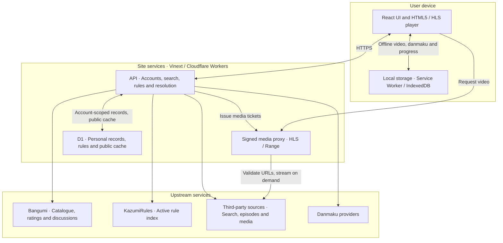

# 系统架构与部署 / Architecture & deployment

[中文介绍](../README.md) · [English overview](../README.en.md)

本文说明当前实现的数据流、部署要求和能力边界。技术细节以源码为准；历史验收日期记录在各专项文档中，不代表所有第三方线路始终可用。

This document describes the implemented data flow, deployment requirements and limits. Source code is authoritative. Dated acceptance records in the linked documents do not guarantee permanent availability of every external source.

## 架构 / Architecture



| 层 / Layer | 实现 / Implementation | 作用 / Responsibility |
| --- | --- | --- |
| 界面 / UI | React、TypeScript、Tailwind CSS | 搜索、季度时间表、追番、观看记录、播放器 / Discovery, schedule, library and playback |
| 服务 / Server | Vinext、Vite、Cloudflare Workers | 请求防护、API、解析、媒体流转发 / Request guards, APIs, resolution and streaming |
| 播放 / Playback | HTML5 video、hls.js；可选 Anime4K WebGPU | 浏览器媒体播放与本机画面增强 / Browser playback and optional local frame enhancement |
| 数据 / Database | Cloudflare D1、Drizzle schema + SQL migrations | 公共缓存、全站规则、账号、个人记录、讨论、站内弹幕 / Public cache, shared rules, accounts, personal records and comments |
| 本机 / Device | localStorage、IndexedDB、Service Worker | 游客记录、待同步队列、下载任务、离线视频和弹幕 / Guest state, retry queues, tasks and offline media/comments |
| 外部 / External | Bangumi、KazumiRules、规则声明的片源、弹幕提供方 | 元数据、评分、有效规则与按需资源 / Metadata, ratings, active rules and on-demand resources |

入口是 `build/sites-worker.ts`：先执行请求防护，再交给 Vinext。`app/api/[...path]/route.ts` 分发目录、分集、规则、解析、媒体、下载、账号、个人库、讨论和弹幕接口。视频通常经签名同源代理；特定线路可以使用解析器明确允许的直连路径。以图搜番在用户确认后由浏览器直接访问 trace.moe，本站不接收识别图片。邮箱通过服务端 Resend HTTPS API 投递。

`build/sites-worker.ts` applies request guards before dispatching to Vinext. `app/api/[...path]/route.ts` handles catalogue, episodes, rules, resolution, media, downloads, accounts, library, discussions and danmaku. Media normally uses the signed same-origin proxy; explicitly supported sources may use a direct path. Screenshot identification calls trace.moe directly from the browser after user confirmation; the site server does not receive the image. Email uses Resend's server-side HTTPS API.

## 数据归属 / Data ownership

- **公共数据**：D1 缓存 Bangumi 元数据、片源目录、公开弹幕等；`site_rule_sets` 保存无需登录的全站有效规则。同步按访问触发，并非无人访问时的定时任务。完整同步成功才删除失效托管规则；失败保留完整旧数据或备用快照。自定义规则和个人开关保持独立。
- **个人数据**：`personal_items` 按账号保存追番、逐集观看进度、别名与弹幕偏好。同步使用版本比较、操作 ID、删除墓碑和本机待上传队列；账号切换隔离数据。个人响应为 `private, no-store`，不会进入公共缓存。游客可浏览和播放，个人状态暂存浏览器；登录后按现有迁移流程合并。
- **视频与本机文件**：视频、离线弹幕、导入字幕、截图不存入 D1。R2 当前未启用。站内离线库保存在设备 IndexedDB；浏览器原生下载保存到用户选择的位置。清理网站数据或浏览器回收存储会移除本机离线库。

- **Public data:** D1 caches metadata, source directories and public comments. `site_rule_sets` stores shared active rules without requiring visitor login. Synchronization is visit-driven, not an unattended cron. Managed removals require a complete successful feed; failures retain complete prior data or the bundled fallback. Custom rules and local preferences remain separate.
- **Personal data:** `personal_items` stores account-scoped watchlists, episode progress, aliases and danmaku preferences. Version checks, operation IDs, tombstones and a local outbox handle retries and conflicts. Account changes isolate state. Private responses use `private, no-store` and never enter the public cache. Guests can browse/play with browser-local records, which can later be merged through the existing sign-in migration.
- **Device files:** D1 does not store video, offline comment files, imported subtitles or screenshots. R2 is not enabled. The in-site offline library uses device IndexedDB; native browser downloads use the selected local destination. Clearing website data or browser storage eviction can remove offline files.

## 缓存与请求保护 / Caching & request protection

| 数据 / Data | 新鲜期 / Fresh | 额外回退期 / Additional stale fallback |
| --- | --- | --- |
| 搜索目录 / Search catalogue | 5 分钟 / minutes | 24 小时 / hours |
| 季度时间表 / Seasonal schedule | 1 小时 / hour | 7 天 / days |
| 季度首页推荐 / Seasonal home recommendations | 1 小时 / hour | 24 小时 / hours |
| 番剧详情 / Subject details | 6 小时 / hours | 24 小时 / hours |
| 分集元数据 / Episode metadata | 10 分钟 / minutes | 24 小时 / hours |
| 片源搜索 / Source searches | 2 分钟 / minutes | 1 小时 / hour |
| 片源目录 / Source directories | 10 分钟 / minutes | 1 小时 / hour |

`lib/server-cache.ts` 合并同一 Worker 实例中的并发查询，限制缓存条目/内存，后台刷新可用旧值并明确标记陈旧结果。失败响应不写成成功缓存；数据库故障尽量退回上游请求。带授权字段的自定义规则绕过共享目录缓存。缓存目录存在不代表视频一定可播。

`lib/server-cache.ts` coalesces concurrent reads within a Worker isolate, bounds cache entries/memory, and labels stale fallback while revalidating. Failures are not cached as successful empty results. Database outages fall back to upstream access where possible. Custom rules containing authorization fields bypass the shared directory cache. A cached directory does not prove successful playback.

入口校验接口、方法、Origin、JSON 类型及请求体大小，限制客户端和实例级请求频率与并发，拥堵返回 `429`/`503` 及适用的 `Retry-After`。限流标识使用 HMAC，不在计数表保存原始 IP。媒体票据约 8 小时有效；媒体代理检查公共 HTTPS 地址、重定向、响应类型和 Range，重写 HLS 播放列表、密钥与分片引用，并限制读取规模。源站脚本不在应用中执行。

The entrypoint validates routes, methods, Origin, JSON type and body size, and applies client/isolate rate and concurrency limits with `429`/`503` and applicable `Retry-After`. Rate identifiers are HMAC-derived rather than raw IPs. Media tickets last about eight hours. The proxy validates public HTTPS destinations, redirects, response types and Range requests, rewrites HLS playlist/key/segment references and bounds reads. Remote source scripts are not executed inside the application.

这些是应用级保护，不能等同于完整 DDoS/WAF 防护。网络层防护、机器人策略、费用限制和告警由托管平台配置。域名检查没有 DNS 地址固定，不构成完整 DNS rebinding 防御。

These are application protections, not a complete DDoS/WAF service. Network protection, bot rules, spending controls and alerts require hosting-provider configuration. Hostname checks do not pin DNS results and are not a complete DNS-rebinding defense.

## 身份与邮件 / Identity & email

默认账号为本站邮箱/密码账号，支持邮箱验证注册、旧账号补验、单次链接密码重置。密码为 12–128 字符，经服务端 pepper 和带盐 PBKDF2-HMAC-SHA256 保存；会话 Cookie 为 Secure、HttpOnly、SameSite=Lax，最长七天。D1 仅保存会话/邮件凭证摘要，重置密码撤销既有会话。实际发信需要配置正式发件服务；缺配置时显示服务未就绪，不假装邮件已发出。

The default account uses this site's email/password flow, with verified registration, legacy-account verification and single-use password reset links. Passwords are 12–128 characters and stored using a server pepper and salted PBKDF2-HMAC-SHA256. Session cookies are Secure, HttpOnly and SameSite=Lax, lasting up to seven days. D1 stores session/action-token hashes. Password reset revokes existing sessions. Real delivery requires a configured sender; missing configuration produces an explicit unavailable state.

ChatGPT 身份仅为历史记录兼容，不按相同邮箱自动合并账号。此兼容层依赖 Sites 可信入口注入身份请求头。自托管必须剥离公网传入的 `oai-authenticated-user-*` 头，仅允许可信身份层重新注入，或禁用这段历史适配；不能把客户端自填的身份头当作登录证明。

ChatGPT identity remains solely for legacy record compatibility; matching email addresses do not automatically link accounts. That adapter depends on trusted Sites identity headers. A self-hosted deployment must strip incoming `oai-authenticated-user-*` headers and allow only its trusted identity layer to inject them, or disable the legacy adapter. Client-supplied identity headers are not proof of authentication.

## 环境与数据库 / Environment & database

| 名称 / Name | 配置 / Configuration | 用途 / Purpose |
| --- | --- | --- |
| `DB` | D1 binding | 公共缓存、规则、账号和记录 / Cache, rules, accounts and records |
| `LINGQI_MEDIA_SECRET` | Secret；建议至少 32 随机字节 / at least 32 random bytes recommended | 媒体签名与限流标识 / Media signing and rate identifiers |
| `LINGQI_AUTH_SECRET` | Secret；至少 32 字符且稳定保存 / at least 32 characters; preserve it | 密码 pepper；变更会使旧密码无法验证 / Password pepper; changing it breaks existing password verification |
| `RESEND_API_KEY` | 可选 Secret / optional secret | 邮件服务 API / Mail service API |
| `LINGQI_MAIL_FROM` | 已验证发件域名地址 / verified sender address | 注册验证和恢复邮件 / Verification and recovery sender |
| `LINGQI_SITE_URL` | 固定 HTTPS 根地址 / fixed HTTPS origin | 邮件确认链接，不从请求 Host 推导 / Mail action links; never inferred from request Host |
| `LINGQI_DANDAN_APP_ID` | 可选服务器 Secret / optional server secret | 本站获批的弹弹play应用 / This site's approved Dandanplay application |
| `LINGQI_DANDAN_APP_SECRET` | 可选服务器 Secret / optional server secret | 弹弹play请求签名 / Dandanplay request signing |

生产环境由托管平台设置 secrets；不要提交凭证、真实验证链接、账号数据或生成的构建目录。弹弹play需要本站自己的授权，不复用其他应用凭证。邮件变量缺失不影响已有账号登录，但不能完成需要邮件的新注册/验证/找回。参见 [邮箱配置](email-accounts.md) 和 [弹幕配置](danmaku.md)。

Configure production secrets through the host. Never commit credentials, real action links, account data or generated bundles. Dandanplay requires credentials authorized for this site. Missing mail settings do not prevent existing-account login, but mail-dependent registration/verification/recovery remain unavailable. See [email setup](email-accounts.md) and [danmaku setup](danmaku.md).

<a id="development-and-deployment"></a>

## 开发与部署 / Development and deployment

### 本地开发 / Local development

要求 Node.js ≥22.13.0、项目固定的 pnpm 11.25.0。干净克隆默认使用 portable 执行配置。

Use Node.js ≥22.13.0 and the project-pinned pnpm 11.25.0. A clean clone defaults to the portable execution profile.

```sh
pnpm install --frozen-lockfile
pnpm dev
```

默认开发地址为 `http://localhost:5173`。`pnpm build` 生成 Worker 与静态文件；`pnpm start` 使用 Wrangler 在本机运行该产物。账号和公共缓存需要数据库迁移，生成迁移的 `pnpm db:generate` 不等于应用迁移。

The default development URL is `http://localhost:5173`. `pnpm build` produces the Worker and static assets; `pnpm start` runs those artifacts locally with Wrangler. Accounts and database-backed caching require migrations. `pnpm db:generate` generates migration files; it does not apply them.

### 本地构建产物与迁移 / Local built preview & migrations

下列方案只操作本机 D1。构建后的 Wrangler 配置是生成文件；为它补充仓库迁移目录，然后使用 Wrangler 的迁移记录避免重复应用 `ALTER TABLE`。每次重新构建后，需重新补充生成配置中的迁移路径。

The following procedure targets local D1 only. The generated Wrangler config needs the repository's migration path. Wrangler tracks applied migrations, avoiding repeated `ALTER TABLE` execution. Repeat the config preparation after rebuilding.

```sh
pnpm build
node --input-type=module <<'NODE'
import { readFileSync, writeFileSync } from 'node:fs';
const file = 'dist/server/wrangler.json';
const config = JSON.parse(readFileSync(file, 'utf8'));
for (const database of config.d1_databases ?? []) {
  if (database.binding === 'DB') database.migrations_dir = '../../drizzle';
}
writeFileSync(file, JSON.stringify(config, null, 2));
NODE
pnpm exec wrangler d1 migrations apply DB --local --config dist/server/wrangler.json --persist-to .wrangler/state
pnpm start
```

本地生产预览需要的 secrets 可放在 `dist/server/.dev.vars`，与此处使用的 Wrangler 配置同目录；该目录已被 Git 忽略。生成两份独立随机值用于媒体和账号 secret。不要把本地测试值用于生产；也不要将 secrets 写进根目录未忽略的文件。完整邮箱流程应通过你控制的 HTTPS 测试站点和正式配置的发件服务验收，不能用本地页面加载代替真实投递验收。

For the built local preview, put test secrets in `dist/server/.dev.vars`, beside this Wrangler config; `dist/` is Git-ignored. Generate independent random media and auth secrets. Never reuse test values in production or write secrets to unignored root files. Validate the complete mail flow on a controlled HTTPS test deployment with a configured sender; a local page load does not verify real delivery.

### 发布 / Publishing

在 Sites 部署时保留 `sites()` 构建集成，为自己的副本绑定新的项目身份，保持 `.openai/hosting.json` 的 D1 绑定为 `DB`。构建会将 `drizzle/` 复制到 `dist/.openai/drizzle/` 交给托管工作流；发布前应确认目标数据库已经应用全部迁移。不要在请求处理函数中自动建表，也不要把本地占位 database ID 当作生产数据库。其他 Cloudflare 托管方式需自行配置真实 D1、资源目录、secrets、可信身份入口和迁移流程。

For Sites deployment, retain the `sites()` integration, bind your fork to its own project identity and keep the manifest's D1 binding as `DB`. The build copies `drizzle/` to `dist/.openai/drizzle/` for the hosting workflow; confirm all migrations are applied to the target database before serving. Do not create tables in request handlers or treat the local placeholder database ID as production. Other Cloudflare deployments must configure their real D1, assets, secrets, trusted identity boundary and migration process.

## 浏览器及上游边界 / Browser & upstream limits

- 片源目录、解析成功、实际首帧是不同证据。源站可能验证、限区、超时或更换地址；本站显示错误并支持换源，不绕过验证、DRM 或区域认证。
- 离线库支持可读取的 MP4/WebM 和支持范围内的非加密点播 HLS；单集最多 1 GB，最多 100 条本机任务。HLS 完整分片可续传，列表变化时拒绝错误拼接。站内任务需要网站保持打开，关闭后保留已提交分片供恢复；原生文件下载由浏览器管理。详细边界见 [下载与个人工具](resume-share-and-personal-tools.md)。
- WebGPU、Cast、AirPlay、画中画及本机存储权限取决于浏览器/设备。Anime4K、站内弹幕和截图不会改变远程接收设备或原生画中画输出。直连视频截图还受源站跨域许可限制。
- 未实现原生 DLNA 扫描、系统解码器设置、Syncplay、Bangumi OAuth 收藏同步和 WebDAV；不提供无效网页开关模拟这些能力。参见 [上游功能对照](upstream-feature-review.md)。

- Source-directory availability, resolved media and an actual first frame are different evidence. Sources may impose verification, region restrictions, timeouts or URL changes. Errors and source switching are supported; verification, DRM and regional authentication are not bypassed.
- Offline storage supports readable MP4/WebM and supported unencrypted on-demand HLS, with a 1 GB episode limit and 100 local tasks. Complete HLS fragments can be reused; changed playlists cannot be incorrectly spliced. In-site tasks need the website open; closing it preserves committed chunks for later recovery. Native downloads are browser-managed. See [downloads and personal tools](resume-share-and-personal-tools.md).
- WebGPU, Cast, AirPlay, picture-in-picture and storage access depend on browser/device capabilities. Anime4K, site danmaku and screenshots do not modify receiver/native PiP output. Direct-video frame capture also requires upstream CORS permission.
- Native DLNA discovery, system decoder settings, Syncplay, Bangumi OAuth library sync and WebDAV are not implemented. The UI does not simulate them with ineffective switches. See the [upstream feature matrix](upstream-feature-review.md).

## 验证入口 / Validation entrypoints

```sh
node scripts/check-web.mjs
node scripts/check-player.cjs
node scripts/check-library.cjs
node scripts/check-security-cache.cjs
node scripts/check-offline.cjs
node scripts/check-email-recovery.cjs
pnpm exec tsc --noEmit
pnpm build
```

这些检查覆盖代码路径和受控上游响应；真实视频、邮件收件箱、投屏接收器、GPU 画质和浏览器兼容性仍需对应环境实测。仓库另有各功能的 `scripts/check-*.cjs` 回归脚本。

These checks exercise implementation paths and controlled upstream responses. Real media, email inbox delivery, casting receivers, GPU quality and browser compatibility still require suitable live environments. Additional feature regressions live in `scripts/check-*.cjs`.
